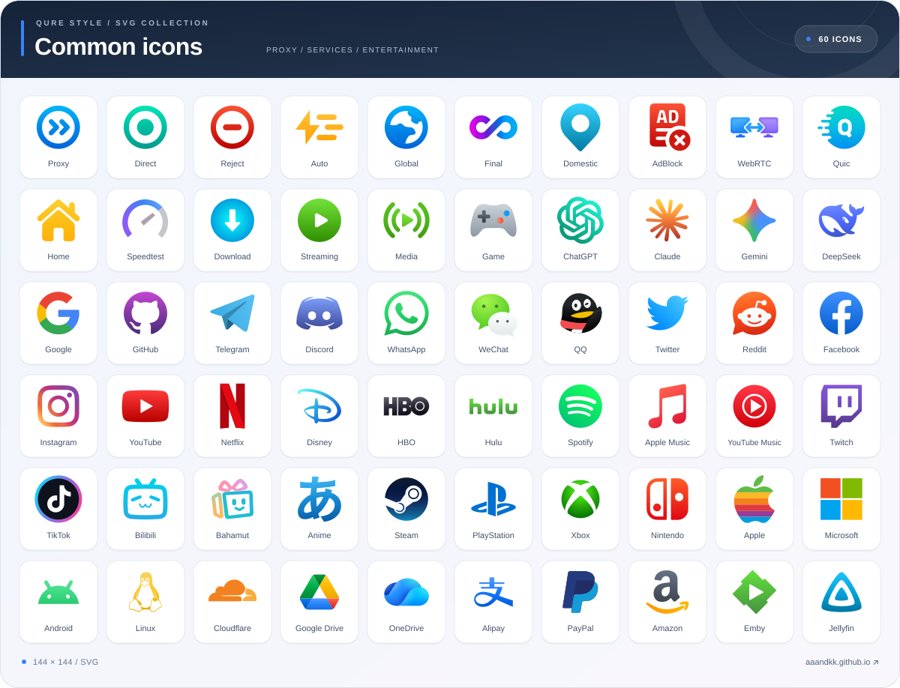
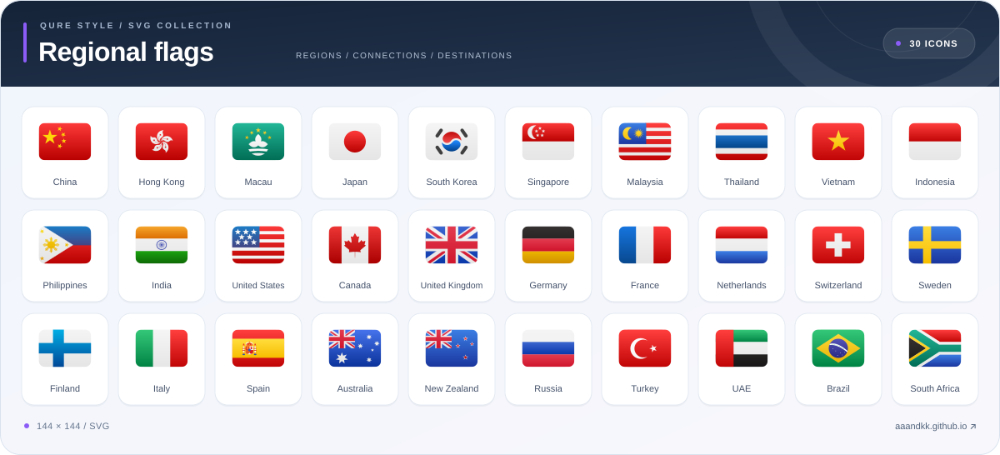

# Qure-Style-SVG

[English](README_en.md) · [简体中文](README.md)

Qure 风格的 SVG 图标集，包含 **2269 个 SVG**：**1999 个通用图标**、**270 个地区与组织旗帜**，统一为 **144 × 144** 画布，其中旗帜 SVG 均采用**贝塞尔丝滑曲率绘制圆角**。可按 icon 设计规范提交 **PR** 补全缺失图标。

**[前往图标预览站 →](https://aaandkk.github.io/qure/)**

搜索、预览、下载图标及复制链接，请访问预览网站。

---

## 🔮 图标包订阅


**Qure-Style-SVG** · 2269 个图标 · 作者：[aaANDkk](https://github.com/aaANDkk)

复制下方订阅链接，添加到支持 JSON 图标集和 SVG 图片的客户端（如 FlClash 和 Bettbox ）：

```text
https://raw.githubusercontent.com/aaANDkk/Qure_Style_SVG/main/Other/Qure-Style-SVG.json
```

> [!NOTE]
> 清单中的图片为 SVG 矢量格式；客户端需同时支持 JSON 图标集和 SVG 格式。仅支持 PNG 的客户端不能直接使用此图标包。客户端如 **Bettbox** 已内置此图标包。

---

## 🎨 图标预览

### 通用图标 · 精选 60 个

代理策略、广告拦截、AI、流媒体、社交与常用服务。完整图标请前往[图标预览站](https://aaandkk.github.io/qure/)查看。

[](https://aaandkk.github.io/qure/)

### 地区旗帜 · 精选 30 个

常用地区的旗帜预览。完整图标请前往[图标预览站](https://aaandkk.github.io/qure/)查看。

[](https://aaandkk.github.io/qure/)

---

## 🔗 单个图标使用

在[图标预览站](https://aaandkk.github.io/qure/)搜索图标并复制链接，也可使用以下原始文件链接（文件名区分大小写）：

- **通用图标示例**：
  ```text
  https://raw.githubusercontent.com/aaANDkk/Qure_Style_SVG/main/icon/svg/common/ChatGPT.svg
  ```

- **旗帜图标示例**：
  ```text
  https://raw.githubusercontent.com/aaANDkk/Qure_Style_SVG/main/icon/svg/flag/Japan.svg
  ```

- **Mihomo / Clash 配置示例**：
  ```yaml
  icon: "https://raw.githubusercontent.com/aaANDkk/Qure_Style_SVG/main/icon/svg/flag/Japan.svg"
  ```

---

## 📁 目录结构

| 目录 / 文件 | 说明 |
| :--- | :--- |
| [`icon/svg/common/`](icon/svg/common/) | 通用 SVG 图标源文件 |
| [`icon/svg/flag/`](icon/svg/flag/) | 地区与组织旗帜 SVG 源文件 |
| [`docs/assets/`](docs/assets/) | 精选 SVG 预览图 |
| [`Other/Qure-Style-SVG.json`](Other/Qure-Style-SVG.json) | 图标包清单 |
| [`licenses/`](licenses/) | 第三方许可文本 |

> [!TIP]
> 所有图标源文件均为 SVG 格式，完整图标库请前往[图标预览站](https://aaandkk.github.io/qure/)查看。

---

## 💕 鸣谢与使用说明

- [Koolson / Qure](https://github.com/Koolson/Qure)：图标风格与部分图标重绘参考。
- [flag-icons](https://github.com/lipis/flag-icons)、[circle-flags](https://github.com/HatScripts/circle-flags)、[LobeHub Icons](https://github.com/lobehub/lobe-icons)、[Bettbox](https://github.com/appshubcc/Bettbox)、[Simple Icons](https://github.com/simple-icons/simple-icons) 等：部分几何轮廓与品牌素材来源。

本项目为非官方整理与风格化 SVG 图标集，与 Qure 官方项目无隶属关系。品牌名称与标志归各自权利人所有；相关素材请遵循其原有许可及使用要求。Qure 参考与重绘部分保留原作者署名，按原项目要求用于学习交流，不用于商业盈利。详细来源和许可见 [第三方说明](THIRD_PARTY_NOTICES.md)。
