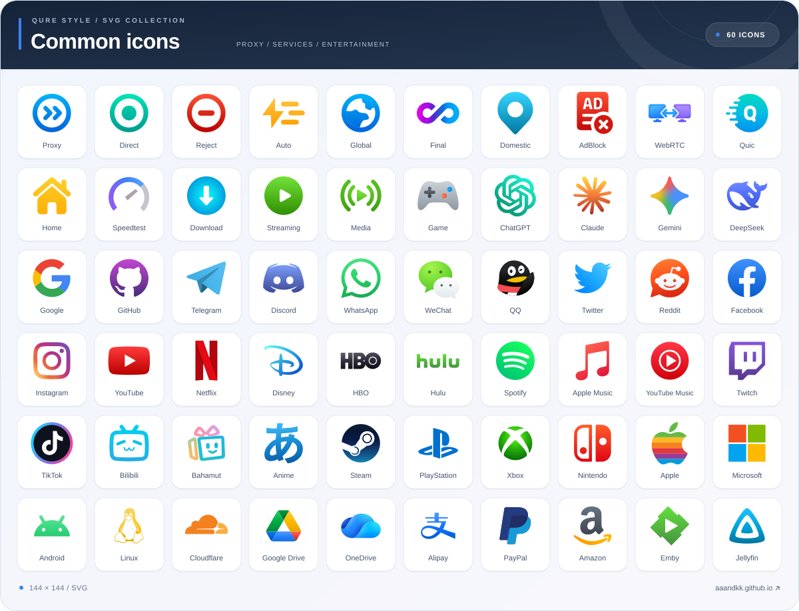
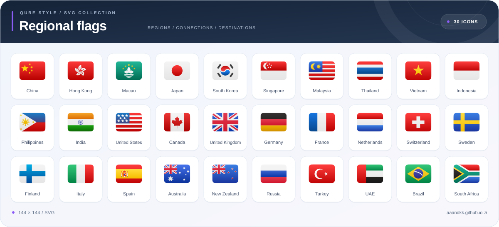

# Qure-Style-SVG

[English](README_en.md) · [简体中文](README.md)

A Qure-style SVG icon pack containing **2,269 SVGs**: **1,999 common icons** and **270 regional & organization flags**, standardized to a **144 × 144** canvas. All flag SVGs feature **continuous Bézier curvature rounded corners**. Pull requests (**PRs**) following the icon design specifications are welcome to add missing icons.

**[Browse the icon website →](https://aaandkk.github.io/)** · [Icon Pack JSON](Other/Qure-Style-SVG.json)

Search, preview, download, and copy icon links on the website.

---

## 🔮 Icon Pack Subscription


**Qure-Style-SVG** · 2,269 icons · Author: [aaANDkk](https://github.com/aaANDkk)

Copy the subscription link below and add it to clients supporting JSON icon collections and SVG images (such as FlClash and Bettbox):

```text
https://raw.githubusercontent.com/aaANDkk/Qure_Style_SVG/main/Other/Qure-Style-SVG.json
```

> [!NOTE]
> All images in the manifest are in SVG vector format; the client must support both JSON icon collections and SVG images. Clients that only support PNG cannot use this icon pack directly. Clients such as **Bettbox** already have this icon pack built-in.

---

## 🎨 Icon Preview

### Common Icons · 60 Selected Icons

Proxy policies, ad blocking, AI, streaming, social platforms, and everyday services. Browse the full collection on the [website](https://aaandkk.github.io/).

[](https://aaandkk.github.io/)

### Regional Flags · 30 Selected Flags

A preview of commonly used regions. Browse the full collection on the [website](https://aaandkk.github.io/).

[](https://aaandkk.github.io/)

---

## 🔗 Using Individual Icons

Find an icon on the [website](https://aaandkk.github.io/) and copy its URL, or use the raw file URLs below (filenames are case-sensitive):

- **Common Icon Example**:
  ```text
  https://raw.githubusercontent.com/aaANDkk/Qure_Style_SVG/main/icon/svg/common/ChatGPT.svg
  ```

- **Flag Icon Example**:
  ```text
  https://raw.githubusercontent.com/aaANDkk/Qure_Style_SVG/main/icon/svg/flag/Japan.svg
  ```

- **Mihomo / Clash Configuration Example**:
  ```yaml
  icon: "https://raw.githubusercontent.com/aaANDkk/Qure_Style_SVG/main/icon/svg/flag/Japan.svg"
  ```

---

## 📁 Directory Structure

| Directory / File | Description |
| :--- | :--- |
| [`icon/svg/common/`](icon/svg/common/) | Common SVG source files |
| [`icon/svg/flag/`](icon/svg/flag/) | Regional & organization flag SVG source files |
| [`docs/assets/`](docs/assets/) | Selected SVG preview images |
| [`Other/Qure-Style-SVG.json`](Other/Qure-Style-SVG.json) | Icon pack manifest |
| [`licenses/`](licenses/) | Third-party license texts |

> [!TIP]
> All icon source files use SVG. Visit the [website](https://aaandkk.github.io/) for the complete collection.

---

## 💕 Acknowledgements & Usage Notes

- [Koolson / Qure](https://github.com/Koolson/Qure): Icon style and vector redraw references for parts of icons.
- [flag-icons](https://github.com/lipis/flag-icons), [circle-flags](https://github.com/HatScripts/circle-flags), [LobeHub Icons](https://github.com/lobehub/lobe-icons), [Bettbox](https://github.com/appshubcc/Bettbox), [Simple Icons](https://github.com/simple-icons/simple-icons), etc.: Sources for certain geometric silhouettes and brand materials.

This project is an unofficial curated and stylized SVG icon set and is not affiliated with the official Qure project. Brand names and logos belong to their respective owners; please follow their original licenses and usage requirements. The Qure reference and redrawn portions retain the original author's attribution and are intended for study and exchange as requested by the original project, not for commercial profit. For detailed sources and licenses, see [Third-Party Notices](THIRD_PARTY_NOTICES.md).
