# Qure-Style Regional & Organization Flag Icon Index

[English](README_en.md) · [简体中文](README.md)

A total of **270** SVGs, standardized to **144×144**. Sorted alphabetically by filename. Click icons or filenames to view source files.

[Back to Project README](../../../README_en.md) · [PNG Overview](../../../docs/assets/flags-overview.png?v=ed2cf0f6c6c6) · [Scalable SVG Overview](../../../docs/assets/flags-overview.svg?v=bf0d6f469092)

This index displays all regional and organizational flags.

| Preview | Region / Name | SVG File |
| :---: | :--- | :--- |
|  | Afghanistan | [Afghanistan.svg](Afghanistan.svg) |
|  | Åland Islands | [Aland_Islands.svg](Aland_Islands.svg) |
|  | Albania | [Albania.svg](Albania.svg) |
| [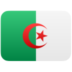](Algeria.svg) | Algeria | [Algeria.svg](Algeria.svg) |
|  | American Samoa | [American_Samoa.svg](American_Samoa.svg) |
|  | Andorra | [Andorra.svg](Andorra.svg) |
|  | Angola | [Angola.svg](Angola.svg) |
|  | Anguilla | [Anguilla.svg](Anguilla.svg) |
| [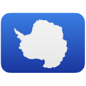](Antarctica.svg) | Antarctica | [Antarctica.svg](Antarctica.svg) |
|  | Antigua and Barbuda | [Antigua_and_Barbuda.svg](Antigua_and_Barbuda.svg) |
| [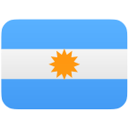](Argentina.svg) | Argentina | [Argentina.svg](Argentina.svg) |
|  | Armenia | [Armenia.svg](Armenia.svg) |
|  | Aruba | [Aruba.svg](Aruba.svg) |
|  | Ascension Island | [Ascension_Island.svg](Ascension_Island.svg) |
|  | ASEAN (Association of Southeast Asian Nations) | [Association_of_Southeast_Asian_Nations.svg](Association_of_Southeast_Asian_Nations.svg) |
|  | Australia | [Australia.svg](Australia.svg) |
|  | Austria | [Austria.svg](Austria.svg) |
| [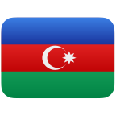](Azerbaijan.svg) | Azerbaijan | [Azerbaijan.svg](Azerbaijan.svg) |
|  | Bahamas | [Bahamas.svg](Bahamas.svg) |
|  | Bahrain | [Bahrain.svg](Bahrain.svg) |
|  | Bangladesh | [Bangladesh.svg](Bangladesh.svg) |
|  | Barbados | [Barbados.svg](Barbados.svg) |
| [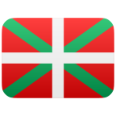](Basque_Country.svg) | Basque Country | [Basque_Country.svg](Basque_Country.svg) |
|  | Belarus | [Belarus.svg](Belarus.svg) |
|  | Belgium | [Belgium.svg](Belgium.svg) |
|  | Belize | [Belize.svg](Belize.svg) |
|  | Benin | [Benin.svg](Benin.svg) |
|  | Bermuda | [Bermuda.svg](Bermuda.svg) |
|  | Bhutan | [Bhutan.svg](Bhutan.svg) |
|  | Bolivia | [Bolivia.svg](Bolivia.svg) |
|  | Caribbean Netherlands (Bonaire, Sint Eustatius and Saba) | [Bonaire_Sint_Eustatius_and_Saba.svg](Bonaire_Sint_Eustatius_and_Saba.svg) |
|  | Bosnia and Herzegovina | [Bosnia_and_Herzegovina.svg](Bosnia_and_Herzegovina.svg) |
|  | Botswana | [Botswana.svg](Botswana.svg) |
|  | Bouvet Island | [Bouvet_Island.svg](Bouvet_Island.svg) |
|  | Brazil | [Brazil.svg](Brazil.svg) |
|  | British Indian Ocean Territory | [British_Indian_Ocean_Territory.svg](British_Indian_Ocean_Territory.svg) |
|  | Brunei | [Brunei_Darussalam.svg](Brunei_Darussalam.svg) |
|  | Bulgaria | [Bulgaria.svg](Bulgaria.svg) |
|  | Burkina Faso | [Burkina_Faso.svg](Burkina_Faso.svg) |
|  | Burundi | [Burundi.svg](Burundi.svg) |
|  | Côte d'Ivoire | [C_te_d_Ivoire.svg](C_te_d_Ivoire.svg) |
|  | Cabo Verde | [Cabo_Verde.svg](Cabo_Verde.svg) |
|  | Cambodia | [Cambodia.svg](Cambodia.svg) |
|  | Cameroon | [Cameroon.svg](Cameroon.svg) |
|  | Canada | [Canada.svg](Canada.svg) |
|  | Canary Islands | [Canary_Islands.svg](Canary_Islands.svg) |
|  | Catalonia | [Catalonia.svg](Catalonia.svg) |
|  | Cayman Islands | [Cayman_Islands.svg](Cayman_Islands.svg) |
|  | Central African Republic | [Central_African_Republic.svg](Central_African_Republic.svg) |
|  | CEFTA (Central European Free Trade Agreement) | [Central_European_Free_Trade_Agreement.svg](Central_European_Free_Trade_Agreement.svg) |
|  | Chad | [Chad.svg](Chad.svg) |
|  | Chile | [Chile.svg](Chile.svg) |
|  | China | [China.svg](China.svg) |
|  | Taiwan (China) | [China_Taiwan.svg](China_Taiwan.svg) |
|  | Christmas Island | [Christmas_Island.svg](Christmas_Island.svg) |
|  | Clipperton Island | [Clipperton_Island.svg](Clipperton_Island.svg) |
|  | Cocos (Keeling) Islands | [Cocos_Keeling_Islands.svg](Cocos_Keeling_Islands.svg) |
|  | Colombia | [Colombia.svg](Colombia.svg) |
| [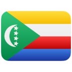](Comoros.svg) | Comoros | [Comoros.svg](Comoros.svg) |
|  | Cook Islands | [Cook_Islands.svg](Cook_Islands.svg) |
|  | Costa Rica | [Costa_Rica.svg](Costa_Rica.svg) |
| [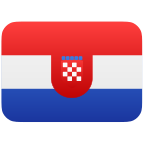](Croatia.svg) | Croatia | [Croatia.svg](Croatia.svg) |
|  | Cuba | [Cuba.svg](Cuba.svg) |
|  | Curaçao | [Cura_ao.svg](Cura_ao.svg) |
|  | Cyprus | [Cyprus.svg](Cyprus.svg) |
|  | Czech Republic (Czechia) | [Czechia.svg](Czechia.svg) |
|  | DR Congo (Democratic Republic of the Congo) | [Democratic_Republic_of_the_Congo.svg](Democratic_Republic_of_the_Congo.svg) |
|  | Denmark | [Denmark.svg](Denmark.svg) |
| [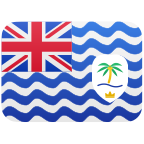](Diego_Garcia.svg) | Diego Garcia | [Diego_Garcia.svg](Diego_Garcia.svg) |
| [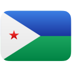](Djibouti.svg) | Djibouti | [Djibouti.svg](Djibouti.svg) |
|  | Dominica | [Dominica.svg](Dominica.svg) |
|  | Dominican Republic | [Dominican_Republic.svg](Dominican_Republic.svg) |
|  | East African Community | [East_African_Community.svg](East_African_Community.svg) |
|  | Ecuador | [Ecuador.svg](Ecuador.svg) |
|  | Egypt | [Egypt.svg](Egypt.svg) |
|  | El Salvador | [El_Salvador.svg](El_Salvador.svg) |
|  | England | [England.svg](England.svg) |
|  | Equatorial Guinea | [Equatorial_Guinea.svg](Equatorial_Guinea.svg) |
|  | Eritrea | [Eritrea.svg](Eritrea.svg) |
|  | Estonia | [Estonia.svg](Estonia.svg) |
|  | Eswatini | [Eswatini.svg](Eswatini.svg) |
|  | Ethiopia | [Ethiopia.svg](Ethiopia.svg) |
|  | European Union | [European_Union.svg](European_Union.svg) |
|  | Falkland Islands | [Falkland_Islands.svg](Falkland_Islands.svg) |
|  | Faroe Islands | [Faroe_Islands.svg](Faroe_Islands.svg) |
|  | Micronesia | [Federated_States_of_Micronesia.svg](Federated_States_of_Micronesia.svg) |
|  | Fiji | [Fiji.svg](Fiji.svg) |
|  | Finland | [Finland.svg](Finland.svg) |
|  | France | [France.svg](France.svg) |
|  | French Guiana | [French_Guiana.svg](French_Guiana.svg) |
| [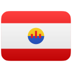](French_Polynesia.svg) | French Polynesia | [French_Polynesia.svg](French_Polynesia.svg) |
|  | French Southern Territories | [French_Southern_Territories.svg](French_Southern_Territories.svg) |
|  | Gabon | [Gabon.svg](Gabon.svg) |
|  | Galicia | [Galicia.svg](Galicia.svg) |
| [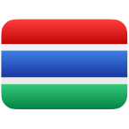](Gambia.svg) | Gambia | [Gambia.svg](Gambia.svg) |
|  | Georgia | [Georgia.svg](Georgia.svg) |
|  | Germany | [Germany.svg](Germany.svg) |
|  | Ghana | [Ghana.svg](Ghana.svg) |
|  | Gibraltar | [Gibraltar.svg](Gibraltar.svg) |
|  | Greece | [Greece.svg](Greece.svg) |
|  | Greenland | [Greenland.svg](Greenland.svg) |
|  | Grenada | [Grenada.svg](Grenada.svg) |
|  | Guadeloupe | [Guadeloupe.svg](Guadeloupe.svg) |
|  | Guam | [Guam.svg](Guam.svg) |
|  | Guatemala | [Guatemala.svg](Guatemala.svg) |
|  | Guernsey | [Guernsey.svg](Guernsey.svg) |
|  | Guinea | [Guinea.svg](Guinea.svg) |
|  | Guinea-Bissau | [Guinea_Bissau.svg](Guinea_Bissau.svg) |
|  | Guyana | [Guyana.svg](Guyana.svg) |
|  | Haiti | [Haiti.svg](Haiti.svg) |
|  | Heard Island and McDonald Islands | [Heard_Island_and_McDonald_Islands.svg](Heard_Island_and_McDonald_Islands.svg) |
|  | Vatican City (Holy See) | [Holy_See.svg](Holy_See.svg) |
|  | Honduras | [Honduras.svg](Honduras.svg) |
|  | Hong Kong (China) | [Hong_Kong.svg](Hong_Kong.svg) |
|  | Hungary | [Hungary.svg](Hungary.svg) |
|  | Iceland | [Iceland.svg](Iceland.svg) |
|  | India | [India.svg](India.svg) |
|  | Indonesia | [Indonesia.svg](Indonesia.svg) |
|  | Iran | [Iran.svg](Iran.svg) |
|  | Iraq | [Iraq.svg](Iraq.svg) |
|  | Ireland | [Ireland.svg](Ireland.svg) |
|  | Isle of Man | [Isle_of_Man.svg](Isle_of_Man.svg) |
|  | Israel | [Israel.svg](Israel.svg) |
|  | Italy | [Italy.svg](Italy.svg) |
|  | Jamaica | [Jamaica.svg](Jamaica.svg) |
|  | Japan | [Japan.svg](Japan.svg) |
|  | Jersey | [Jersey.svg](Jersey.svg) |
|  | Jordan | [Jordan.svg](Jordan.svg) |
|  | Kazakhstan | [Kazakhstan.svg](Kazakhstan.svg) |
|  | Kenya | [Kenya.svg](Kenya.svg) |
| [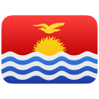](Kiribati.svg) | Kiribati | [Kiribati.svg](Kiribati.svg) |
|  | Kosovo | [Kosovo.svg](Kosovo.svg) |
|  | Kuwait | [Kuwait.svg](Kuwait.svg) |
|  | Kyrgyzstan | [Kyrgyzstan.svg](Kyrgyzstan.svg) |
|  | Laos | [Laos.svg](Laos.svg) |
|  | Latvia | [Latvia.svg](Latvia.svg) |
|  | Arab League | [League_of_Arab_States.svg](League_of_Arab_States.svg) |
|  | Lebanon | [Lebanon.svg](Lebanon.svg) |
|  | Lesotho | [Lesotho.svg](Lesotho.svg) |
|  | Liberia | [Liberia.svg](Liberia.svg) |
|  | Libya | [Libya.svg](Libya.svg) |
|  | Liechtenstein | [Liechtenstein.svg](Liechtenstein.svg) |
|  | Lithuania | [Lithuania.svg](Lithuania.svg) |
|  | Luxembourg | [Luxembourg.svg](Luxembourg.svg) |
|  | Macau (China) | [Macau.svg](Macau.svg) |
|  | Madagascar | [Madagascar.svg](Madagascar.svg) |
|  | Malawi | [Malawi.svg](Malawi.svg) |
|  | Malaysia | [Malaysia.svg](Malaysia.svg) |
| [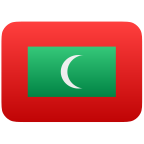](Maldives.svg) | Maldives | [Maldives.svg](Maldives.svg) |
|  | Mali | [Mali.svg](Mali.svg) |
|  | Malta | [Malta.svg](Malta.svg) |
|  | Marshall Islands | [Marshall_Islands.svg](Marshall_Islands.svg) |
|  | Martinique | [Martinique.svg](Martinique.svg) |
| [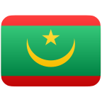](Mauritania.svg) | Mauritania | [Mauritania.svg](Mauritania.svg) |
|  | Mauritius | [Mauritius.svg](Mauritius.svg) |
|  | Mayotte | [Mayotte.svg](Mayotte.svg) |
|  | Mexico | [Mexico.svg](Mexico.svg) |
|  | Moldova | [Moldova.svg](Moldova.svg) |
|  | Monaco | [Monaco.svg](Monaco.svg) |
|  | Mongolia | [Mongolia.svg](Mongolia.svg) |
|  | Montenegro | [Montenegro.svg](Montenegro.svg) |
|  | Montserrat | [Montserrat.svg](Montserrat.svg) |
| [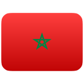](Morocco.svg) | Morocco | [Morocco.svg](Morocco.svg) |
| [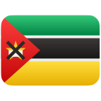](Mozambique.svg) | Mozambique | [Mozambique.svg](Mozambique.svg) |
|  | Myanmar | [Myanmar.svg](Myanmar.svg) |
| [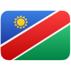](Namibia.svg) | Namibia | [Namibia.svg](Namibia.svg) |
|  | Nauru | [Nauru.svg](Nauru.svg) |
|  | Nepal | [Nepal.svg](Nepal.svg) |
|  | Netherlands | [Netherlands.svg](Netherlands.svg) |
|  | New Caledonia | [New_Caledonia.svg](New_Caledonia.svg) |
|  | New Zealand | [New_Zealand.svg](New_Zealand.svg) |
|  | Nicaragua | [Nicaragua.svg](Nicaragua.svg) |
| [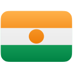](Niger.svg) | Niger | [Niger.svg](Niger.svg) |
|  | Nigeria | [Nigeria.svg](Nigeria.svg) |
|  | Niue | [Niue.svg](Niue.svg) |
|  | Norfolk Island | [Norfolk_Island.svg](Norfolk_Island.svg) |
|  | North Korea | [North_Korea.svg](North_Korea.svg) |
|  | North Macedonia | [North_Macedonia.svg](North_Macedonia.svg) |
|  | Northern Ireland | [Northern_Ireland.svg](Northern_Ireland.svg) |
|  | Northern Mariana Islands | [Northern_Mariana_Islands.svg](Northern_Mariana_Islands.svg) |
|  | Norway | [Norway.svg](Norway.svg) |
|  | Oman | [Oman.svg](Oman.svg) |
|  | Pacific Community | [Pacific_Community.svg](Pacific_Community.svg) |
|  | Pakistan | [Pakistan.svg](Pakistan.svg) |
|  | Palau | [Palau.svg](Palau.svg) |
|  | Panama | [Panama.svg](Panama.svg) |
|  | Papua New Guinea | [Papua_New_Guinea.svg](Papua_New_Guinea.svg) |
| [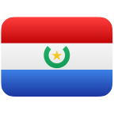](Paraguay.svg) | Paraguay | [Paraguay.svg](Paraguay.svg) |
|  | Peru | [Peru.svg](Peru.svg) |
|  | Philippines | [Philippines.svg](Philippines.svg) |
|  | Pitcairn Islands | [Pitcairn.svg](Pitcairn.svg) |
|  | Poland | [Poland.svg](Poland.svg) |
|  | Portugal | [Portugal.svg](Portugal.svg) |
|  | Puerto Rico | [Puerto_Rico.svg](Puerto_Rico.svg) |
|  | Qatar | [Qatar.svg](Qatar.svg) |
|  | Réunion | [R_union.svg](R_union.svg) |
|  | Republic of the Congo | [Republic_of_the_Congo.svg](Republic_of_the_Congo.svg) |
|  | Romania | [Romania.svg](Romania.svg) |
| [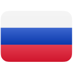](Russia.svg) | Russia | [Russia.svg](Russia.svg) |
|  | Rwanda | [Rwanda.svg](Rwanda.svg) |
|  | Saint Barthélemy | [Saint_Barth_lemy.svg](Saint_Barth_lemy.svg) |
|  | Saint Helena | [Saint_Helena.svg](Saint_Helena.svg) |
|  | Saint Helena, Ascension and Tristan da Cunha | [Saint_Helena_Ascension_and_Tristan_da_Cunha.svg](Saint_Helena_Ascension_and_Tristan_da_Cunha.svg) |
|  | Saint Kitts and Nevis | [Saint_Kitts_and_Nevis.svg](Saint_Kitts_and_Nevis.svg) |
|  | Saint Lucia | [Saint_Lucia.svg](Saint_Lucia.svg) |
|  | Saint Martin (French part) | [Saint_Martin.svg](Saint_Martin.svg) |
|  | Saint Pierre and Miquelon | [Saint_Pierre_and_Miquelon.svg](Saint_Pierre_and_Miquelon.svg) |
|  | Saint Vincent and the Grenadines | [Saint_Vincent_and_the_Grenadines.svg](Saint_Vincent_and_the_Grenadines.svg) |
|  | Samoa | [Samoa.svg](Samoa.svg) |
|  | San Marino | [San_Marino.svg](San_Marino.svg) |
|  | São Tomé and Príncipe | [Sao_Tome_and_Principe.svg](Sao_Tome_and_Principe.svg) |
|  | Saudi Arabia | [Saudi_Arabia.svg](Saudi_Arabia.svg) |
|  | Scotland | [Scotland.svg](Scotland.svg) |
|  | Senegal | [Senegal.svg](Senegal.svg) |
|  | Serbia | [Serbia.svg](Serbia.svg) |
|  | Seychelles | [Seychelles.svg](Seychelles.svg) |
|  | Sierra Leone | [Sierra_Leone.svg](Sierra_Leone.svg) |
| [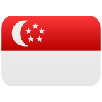](Singapore.svg) | Singapore | [Singapore.svg](Singapore.svg) |
|  | Sint Maarten (Dutch part) | [Sint_Maarten.svg](Sint_Maarten.svg) |
|  | Slovakia | [Slovakia.svg](Slovakia.svg) |
|  | Slovenia | [Slovenia.svg](Slovenia.svg) |
| [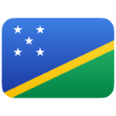](Solomon_Islands.svg) | Solomon Islands | [Solomon_Islands.svg](Solomon_Islands.svg) |
|  | Somalia | [Somalia.svg](Somalia.svg) |
|  | South Africa | [South_Africa.svg](South_Africa.svg) |
| [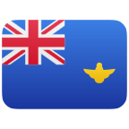](South_Georgia_and_the_South_Sandwich_Islands.svg) | South Georgia and South Sandwich Islands | [South_Georgia_and_the_South_Sandwich_Islands.svg](South_Georgia_and_the_South_Sandwich_Islands.svg) |
|  | South Korea | [South_Korea.svg](South_Korea.svg) |
|  | South Sudan | [South_Sudan.svg](South_Sudan.svg) |
|  | Spain | [Spain.svg](Spain.svg) |
|  | Sri Lanka | [Sri_Lanka.svg](Sri_Lanka.svg) |
|  | Palestine | [State_of_Palestine.svg](State_of_Palestine.svg) |
|  | Sudan | [Sudan.svg](Sudan.svg) |
| [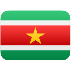](Suriname.svg) | Suriname | [Suriname.svg](Suriname.svg) |
|  | Svalbard and Jan Mayen | [Svalbard_and_Jan_Mayen.svg](Svalbard_and_Jan_Mayen.svg) |
|  | Sweden | [Sweden.svg](Sweden.svg) |
|  | Switzerland | [Switzerland.svg](Switzerland.svg) |
|  | Syria | [Syria.svg](Syria.svg) |
|  | Tajikistan | [Tajikistan.svg](Tajikistan.svg) |
| [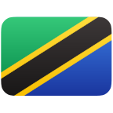](Tanzania.svg) | Tanzania | [Tanzania.svg](Tanzania.svg) |
|  | Thailand | [Thailand.svg](Thailand.svg) |
| [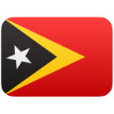](Timor_Leste.svg) | Timor-Leste | [Timor_Leste.svg](Timor_Leste.svg) |
|  | Togo | [Togo.svg](Togo.svg) |
|  | Tokelau | [Tokelau.svg](Tokelau.svg) |
|  | Tonga | [Tonga.svg](Tonga.svg) |
|  | Trinidad and Tobago | [Trinidad_and_Tobago.svg](Trinidad_and_Tobago.svg) |
|  | Tristan da Cunha | [Tristan_da_Cunha.svg](Tristan_da_Cunha.svg) |
|  | Tunisia | [Tunisia.svg](Tunisia.svg) |
|  | Turkey | [Turkey.svg](Turkey.svg) |
|  | Turkmenistan | [Turkmenistan.svg](Turkmenistan.svg) |
|  | Turks and Caicos Islands | [Turks_and_Caicos_Islands.svg](Turks_and_Caicos_Islands.svg) |
|  | Tuvalu | [Tuvalu.svg](Tuvalu.svg) |
|  | Uganda | [Uganda.svg](Uganda.svg) |
|  | Ukraine | [Ukraine.svg](Ukraine.svg) |
|  | United Arab Emirates | [United_Arab_Emirates.svg](United_Arab_Emirates.svg) |
|  | United Kingdom | [United_Kingdom.svg](United_Kingdom.svg) |
|  | United Nations | [United_Nations.svg](United_Nations.svg) |
|  | United States | [United_States.svg](United_States.svg) |
|  | U.S. Outlying Islands | [United_States_Minor_Outlying_Islands.svg](United_States_Minor_Outlying_Islands.svg) |
| [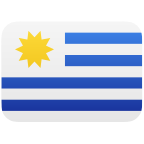](Uruguay.svg) | Uruguay | [Uruguay.svg](Uruguay.svg) |
| [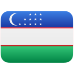](Uzbekistan.svg) | Uzbekistan | [Uzbekistan.svg](Uzbekistan.svg) |
| [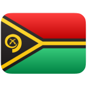](Vanuatu.svg) | Vanuatu | [Vanuatu.svg](Vanuatu.svg) |
| [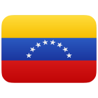](Venezuela.svg) | Venezuela | [Venezuela.svg](Venezuela.svg) |
|  | Vietnam | [Vietnam.svg](Vietnam.svg) |
|  | British Virgin Islands | [Virgin_Islands_British.svg](Virgin_Islands_British.svg) |
|  | U.S. Virgin Islands | [Virgin_Islands_U_S.svg](Virgin_Islands_U_S.svg) |
|  | Wales | [Wales.svg](Wales.svg) |
|  | Wallis and Futuna | [Wallis_and_Futuna.svg](Wallis_and_Futuna.svg) |
|  | Western Sahara | [Western_Sahara.svg](Western_Sahara.svg) |
|  | Yemen | [Yemen.svg](Yemen.svg) |
|  | Zambia | [Zambia.svg](Zambia.svg) |
|  | Zimbabwe | [Zimbabwe.svg](Zimbabwe.svg) |
